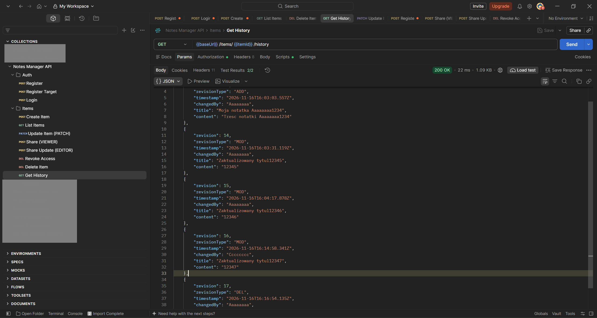
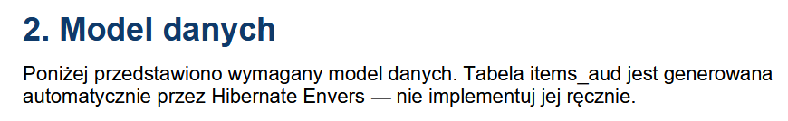

# Notes Manager - Betacom - Zadanie rekrutacyjne - Piotr Łęcicki
## Instrukcja uruchomienia

### Docker Compose
Uruchomić Docker Engine np. poprzez uruchomienie Docker Desktop

Następnie:

```bash
docker compose up --build
```
Zawartość docker-compose:
1. **init-env** — tworzy plik `.env` (kopiuje z `.env.example`). To jest imitacja środowiska ze zmiennymi środowiskowymi,
2. **db** — MySQL 8.4 (baza `Notes manager`, użytkownik `admin`), port `3306`, Schemat bazy tworzy automatycznie **Liquibase** przy starcie aplikacji.

3. **app** — Spring Boot, port `8080`.

Aplikacja: `http://localhost:8080`, baza: `localhost:3306`.

## Architektura i decyzje projektowe

Warstwy: `controller` → `service` → `repository` → `entity` (+ `dto`, `exception`, `security`, `config`). Logika domenowa w serwisach, dostęp do danych przez Spring Data JPA.

- **Java 21**
- **Spring Boot 3.5 + MySQL 8 + Hibernate/JPA**.
- **Hibernate Envers** — audyt historii zmian
   - Encja `Item` ma `@Audited`
   - Historia pobierana przez Audit Query API.
   - Widać kto dokonał zmiany (`changedBy`).
- **JWT (biblioteka JJWT)** — token w nagłówku `Authorization: Bearer ...`.
   - **401** brakujący/nieważny token,
   - **403** brak uprawnień do zasobu.
- **Autoryzacja zasobowa** — Role nadawane w tabeli `item_permissions`. `ItemAccessService` sprawdza rolę:
   - OWNER (pełny dostęp),
   - EDITOR (edycja),
   - VIEWER (odczyt).
- **Optimistic locking**
   - Pole `@Version`.
   - PATCH wymaga aktualnej wartości `version`.
   - Niezgodność → **409** z aktualną wersją w odpowiedzi.
- **Soft delete**
   - `DELETE` ustawia flagę `deleted = true` (rekord zostaje w bazie).
   - Zapytania listujące filtrują usunięte.
   - W historii usunięcie pokazywane jako **DEL**.
- **Rate limiting (Bucket4j)**
   - `POST /login` ograniczony do 5 prób/min na IP
   - Przy przekroczeniu **429** + nagłówek `Retry-After`.
- **Logowanie (SLF4J + Logback)**
  - Logi operacji z parametrami (`@Slf4j`): użytkownik, item, rola, wersja, IP.
  - Każde żądanie dostaje unikalny **Correlation-Id** (`X-Correlation-Id`) zapisywany w MDC i zwracany w nagłówku odpowiedzi
  - Tokeny JWT, hasła, inne dane wrażliwe nie są logowane.
- **i18n** — komunikaty błędów i walidacji w `messages.properties`.
- **Testy**
   - Mockito (jednostkowe),
   - `@WebMvcTest` (warstwa HTTP),
   - Testcontainers MySQL (integracja: Envers, rate limiting, autoryzacja).


## Konfigurowalne parametry (`application.properties`)

| Parametr | Domyślnie                                  | Opis |
|---|--------------------------------------------|---|
| `spring.datasource.url` | `jdbc:mysql://localhost:3306/Notes manager` | adres bazy (składowe: `MYSQL_HOST`, `MYSQL_PORT`) |
| `spring.datasource.username` | `admin`                                    | użytkownik bazy (`MYSQL_USER`) |
| `spring.datasource.password` |                                            | hasło (`MYSQL_NOTES_MANAGER_PASS`, wymagane) |
| `spring.jpa.hibernate.ddl-auto` | `validate`                                 | walidacja schematu (schemat zarządza Liquibase) |
| `jwt.secret` |                                            | klucz podpisu JWT (`JWT_SECRET`) |
| `jwt.expiration-seconds` | `3600`                                     | czas życia tokenu (w sekundach) |
| `rate-limit.login.capacity` | `5`                                        | liczba prób logowania na okno czasowe |
| `rate-limit.login.refill-period-seconds` | `60`                                       | długość okna czasowego (w sekundach) |
| `logging.level.pl.betacom.plecicki.notesmanager` | `DEBUG`                                   | poziom logowania aplikacji (własne klasy) |

## Testowanie w Postman

W katalogu głównym znajduje się kolekcja `notes-manager.postman_collection.json` do testowania wszystkich endpointów.



## Endpointy

| Metoda | Ścieżka | Opis                                           |
|---|---|------------------------------------------------|
| POST | `/register` | rejestracja użytkownika                        |
| POST | `/login` | logowanie (JWT), rate limiting 5/min/IP Bucket4j |
| POST | `/items` | utworzenie notatki                             |
| GET | `/items` | lista notatek widocznych dla zalogowanego      |
| PATCH | `/items/{id}` | edycja (owner/editor, wymaga pola `version`)   |
| DELETE | `/items/{id}` | soft delete zmieniający flagę                  |
| GET | `/items/{id}/history` | historia zmian (ADD/MOD/DEL)                   |
| POST | `/items/{id}/share` | nadanie dostępu (przez OWNER na VIEWER/EDITOR) |
| DELETE | `/items/{id}/share/{userId}` | odebranie dostępu              |

## Odstępstwo od instrukcji — tabela `items_aud`


Fragment instrukcji

Instrukcja zakłada, że tabela `items_aud` zostanie wygenerowana automatycznie przez Hibernate Envers. Celowo zrezygnowałem z tego podejścia, ponieważ wymaga ono ustawienia `spring.jpa.hibernate.ddl-auto=update`, a ja wybrałem ustawienie tego parametru na `validate`. Zamiast tego tabela audytowa `items_aud` jest tworzona przez Liquibase.